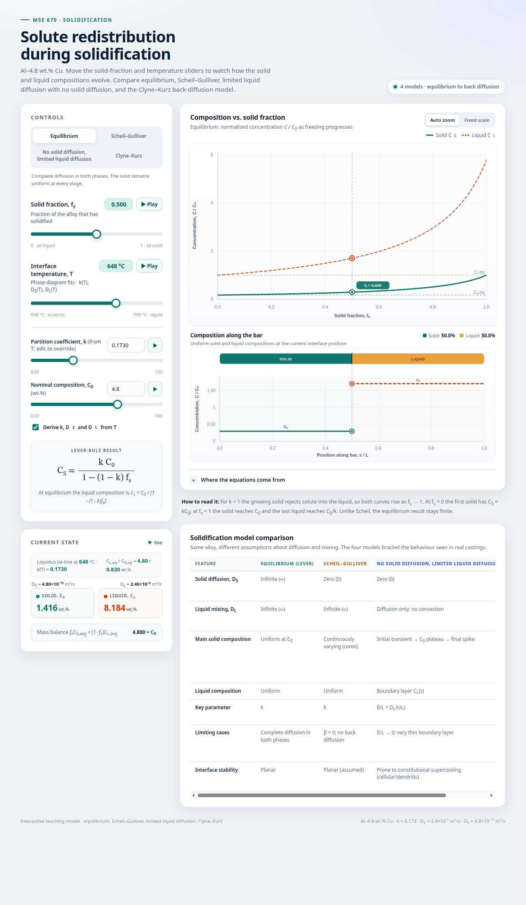

# Solute Redistribution Slider

An interactive graph for **solute redistribution during solidification**, based on the MSE 670 solidification notes. It compares four models that bracket the behaviour seen in real castings, all applied to the same **Al–4.8 wt.% Cu** alloy:

- **Equilibrium (lever rule)** — complete diffusion in both phases.
- **Scheil–Gulliver** — no diffusion in the solid, perfect mixing in the liquid.
- **No solid diffusion, limited liquid diffusion** — diffusion-controlled planar growth: no solid diffusion, no convective mixing in the liquid, and a solute boundary layer ahead of the interface.
- **Clyne–Kurz** — finite solid back diffusion with a fully mixed liquid, plus an optional Won–Thomas coarsening correction.

The alloy is described by `C₀ = 4.8 wt.% Cu`, `k = 0.173`, `D_L = 2.4×10⁻⁹ m²/s`, `D_S = 4.8×10⁻¹⁵ m²/s`, liquidus `T_L = 648 °C`, and solidus/eutectic `T_S = 548 °C`. A **temperature slider** moves the equilibrium tie-line and rescales `k`, `D_S`, and `D_L` through phase-diagram fits and Arrhenius diffusion, anchored at 648 °C (see [How the temperature slider enters](#how-the-temperature-slider-enters)). Logarithmic **`k` and `C₀` sliders** (0.01–100) sit next to editable number boxes, so the same values can be dragged or typed, and editing `k` switches off the temperature coupling.

It comes in two versions that share the same model equations:

- `index.html` — runs in any browser, no installation needed.
- `fs_slider.m` — the same models in a MATLAB app.

Both versions provide the same controls: `f_s`, `T`, and logarithmic `k`/`C₀` sliders (each `k`/`C₀` slider paired with an editable number box) and a **Play** button for every parameter.

**Live demo:** https://1clan.github.io/mse670-solute-redistribution/

> **New here?** Read [`SITE_OVERVIEW.md`](SITE_OVERVIEW.md) for a plain-language explanation of what the site is, who it is for, and what each part of the page shows.



Move the **solid fraction `f_s`** slider from 0 to 1 and watch:

- the solid composition `C_S` (solid line),
- the liquid composition `C_L` (dashed line, or the boundary-layer profile for limited liquid diffusion),
- the **liquidus tie-line** `C_L,eq(T)` / `C_S,eq(T)`, drawn as horizontal dashed references,
- the **composition along the bar**, aligned with the solidified/liquid segments,
- the **solid–liquid connector** at the interface (green to orange),
- the mass-balance check `f_s C_S,avg + (1 − f_s) C_L,avg = C_0`.

Use the **Graph view** switch to choose between `Auto zoom` (the along-bar chart rescales for readability) and `Fixed scale` (the axes, grid, and background stay put and only the plotted data changes as the slider moves).

Every parameter has its own **▶ Play** button: `f_s`, `T`, `k`, and `C₀`. Pressing one sweeps that parameter back and forth across its range and the button toggles to **❚❚ Pause**. Only one animation runs at a time — starting another takes over — and moving any slider or typing in a number box stops the animation. Temperature moves in whole degrees and, while **Derive k, D_s and D_L from T** is checked, rescales all three properties; animating `k` turns that coupling off.

## Models

Pick a model with the 2×2 buttons above the controls. `k` can be any positive number — it is **not** limited to `0 < k ≤ 1`. The temperature slider selects the local liquidus temperature and derives `k`, `D_S`, and `D_L` from it; unchecking the coupling box or editing `k` makes all three independent sensitivity variables.

### Equilibrium (lever rule)

```
C_S = k C_0 / (1 − (1 − k) f_s)
C_L = C_0     / (1 − (1 − k) f_s)
```

Here `k` is the equilibrium partition coefficient and `C_0` is the nominal alloy composition. The solid is uniform at every instant, so the along-bar profile is a sharp step at the interface.

### Scheil–Gulliver

```
C_L = C_0 (1 − f_s)^(k − 1)
C_S = k C_0 (1 − f_s)^(k − 1)
```

The solid that forms at the interface has `C_S* = k C_L`, but it never re-equilibrates. The result is a **cored** solid:

```
C_S(x) = k C_0 (1 − x)^(k − 1),   0 ≤ x ≤ f_s
```

The average composition of all solid formed so far is

```
C_S,avg = C_0 [1 − (1 − f_s)^k] / f_s
```

with `C_S,avg → k C_0` as `f_s → 0`.

### No solid diffusion, limited liquid diffusion

This is the Tiller–Jackson–Rutter–Chalmers case: `D_S = 0`, and the liquid is not convectively mixed. Solute rejected by the growing solid can only spread by **diffusion in the liquid**, so a boundary layer builds up ahead of the interface.

The boundary-layer thickness is set by the growth velocity `v` and the liquid diffusivity `D_L`:

```
δ/L = D_L / (v L)
```

The app uses a fixed characteristic length `L = 1 mm`, so it asks for `v` in µm/s and `D_L` in units of `10⁻⁹ m²/s`. The steady liquid profile is

```
C_L(z) = C_0 [1 + (1 − k)/k · exp(−z/(δ/L))]
```

where `z` is the distance ahead of the interface. The three stages are:

1. **Initial transient** — the first solid is `k C_0` and rises toward `C_0`:

   ```
   C_S(x) ≈ C_0 [k + (1 − k)(1 − exp(−k x/(δ/L)))]
   ```

2. **Steady-state growth** — the interface liquid reaches `C_0/k`, so the solid grows at `C_S = C_0`.

3. **Final transient** — near `f_s = 1` the boundary layer is squeezed against the mold wall and both compositions spike.

The app integrates the solid profile from the local-equilibrium condition and the overall solute balance, so the initial transient, the `C_S = C_0` plateau, and the final spike are mass-conserving. The liquid boundary layer is shown as a separate profile. Keep `δ/L` below about 1 for a thin boundary layer; larger values broaden the layer and the transient.

### Clyne–Kurz (back diffusion)

The liquid is assumed homogeneous, but the solid retains a finite amount of back diffusion. The Fourier number is

```
α = D_s t_f / X² = 4 D_s t_f / λ₂²
```

where `X = λ₂/2` is the representative diffusion distance. Clyne and Kurz replace the Brody–Flemings parameter `β` by

```
β_CK = 2α(1 − exp(−1/α)) − exp(−1/(2α))
```

which is bounded between 0 and 1. The liquid composition follows the generalized back-diffusion form

```
C_L / C_0 = [1 − (1 − β k) f_s]^((k − 1)/(1 − β k))
```

The interface solid obeys local equilibrium, `C_S* = k C_L`, and the average solid composition follows from the solute balance:

```
C_S,avg = [C_0 − (1 − f_s) C_L] / f_s
```

Limiting cases:

- `β → 0` recovers **Scheil–Gulliver** (no back diffusion).
- `β → 1` recovers the **equilibrium lever rule** (complete back diffusion).

`β` is not an independent physical property: it is a lumped back-diffusion parameter computed from `α`, which in turn depends on `D_s`, `t_f`, and `λ₂`. The app shows the derived `β_CK` and also lets you switch on a **direct β override** if you want to study `β` as a sensitivity variable. With the override on, `α` and the Won–Thomas correction are bypassed.

### Won–Thomas coarsening correction

The Won–Thomas extension approximates dendrite coarsening by enlarging the Fourier number:

```
α⁺ = 2(α + α_C),    α_C = 0.1
```

and then recomputing `β_CK` with `α⁺`. The factor of two extends the result to columnar dendrites, while `α_C` accounts for the smaller arm spacing present before coarsening is complete. This is an approximate correction, not a full coarsening model; the empirical secondary-dendrite-arm-spacing fits in the Won–Thomas paper are steel-specific and are not applied here.

### How temperature enters

The notes (pages 7–9) connect solute redistribution to temperature in three steps. First, the steady liquid concentration profile ahead of a planar interface moving at `R` is

```
C_L(z) = C_0 + C_0 ((1 − k)/k) exp(−R z / D_L)
```

with `C_L(0) = C_0/k` at the interface and `C_L(∞) = C_0` far ahead. Second, composition sets the local liquidus temperature through the dilute linear relation

```
T_L = T_m − m C_L
```

where `m` is the positive liquidus slope. At the interface this gives the interface temperature

```
T_i = T_m − m C_0/k
```

and substituting `C_L(z)` gives the liquidus-temperature profile

```
T_L(z) = T_i + m C_0 ((1 − k)/k) [1 − exp(−R z / D_L)]
```

Third, the actual liquid temperature is assumed to follow a constant thermal gradient,

```
T(z) = T_i + G_L z
```

The liquid is constitutionally supercooled wherever `T(z) < T_L(z)`. The maximum liquidus gradient is at `z = 0`:

```
dT_L/dz|_(z=0) = m C_0 (1 − k) R / (k D_L)
```

so the planar interface remains stable when

```
G_L/R ≥ m C_0 (1 − k) / (k D_L)
```

Combining the concentration and temperature profiles also gives liquid composition directly as a function of temperature:

```
C_L(T) = C_0 [1 + ((1 − k)/k) exp(−R (T − T_i)/(D_L G_L))]
```

The notes assume **constant `k`, `D_L`, and `m`**. This derivation is the notes' model: it does not define a temperature-dependent partition coefficient or temperature-dependent diffusivities.

### How the temperature slider enters

The interactive temperature control is an **extension** of the notes' model, not part of it. It couples `T` to the rate parameters through standard Al–Cu phase-diagram data and Arrhenius diffusion, so that moving the slider changes the concentration curves:

```
C_L(T), C_S(T)  from quadratic fits to the Al–Cu liquidus and solidus
k(T) = C_S(T)/C_L(T)
D_S(T) = D_S,ref exp[−(Q_S/R_g)(1/T − 1/T_ref)]
D_L(T) = D_L,ref exp[−(Q_L/R_g)(1/T − 1/T_ref)]
```

The fits pass through `(0, 660.3)`, `(4.8, 648)`, `(33, 548)` for the liquidus and `(0, 660.3)`, `(0.8304, 648)`, `(5.65, 548)` for the solidus:

```
C_L(T): −0.0298060391 C² − 2.41943101 C + 660.3 = T
C_S(T): −1.05070285 C² − 13.93963508 C + 660.3 = T
```

The Arrhenius scaling is anchored to the Al–4.8 wt.% Cu reference at `T_ref = 648 °C`, with `D_S,ref = 4.8×10⁻¹⁵ m²/s`, `D_L,ref = 2.4×10⁻⁹ m²/s`, `Q_S = 130 kJ/mol`, and `Q_L = 30 kJ/mol`. At `T = 648 °C` this gives `C_L = 4.80`, `C_S = 0.830 wt.%`, and `k = 0.173`.

The slider range is `548–700 °C`, default `648 °C`, in whole-degree steps. The **Derive k, D_s and D_L from T** checkbox (on by default) enables the coupling. Typing a `k` value, dragging the `k` slider, or animating `k` switches to manual mode and leaves the D fields editable; re-checking the box re-anchors all three to the current temperature. Above `T_m = 660.3 °C` the alloy is fully liquid, `k(T)` holds its reference value for the limiting curves, and the tie-line is not drawn.

Two caveats follow from the fits. First, `k(T)` is nearly flat for Al–Cu — it moves only from about `0.1712` at 548 °C to `0.1735` near `T_m` — so the equilibrium and Scheil *normalized* curves barely respond to temperature; most of the visible temperature effect comes from `D_S(T)` and `D_L(T)` in the Clyne–Kurz and limited-diffusion models. Second, the fits are a local approximation to the Al–Cu phase diagram, not a full thermodynamic description. The linear liquidus in the notes remains the cleanest dilute-alloy approximation for the tie-line itself.

The local solidification time can be tied to the cooling rate through

```
t_f ≈ (T_L − T_S)/CR
```

which gives `t_f ≈ 100 s` for `CR = 1 °C/s` and the Al–Cu freezing range. `t_f` remains an input so that cooling-rate sensitivity can be explored independently.

## Model comparison

| Feature | Equilibrium | Scheil–Gulliver | No solid diffusion, limited liquid diffusion | Clyne–Kurz |
|---|---|---|---|---|
| Solid diffusion `D_S` | Infinite | Zero | Zero | Finite; back diffusion included |
| Liquid mixing `D_L` | Infinite | Infinite | Diffusion only; no convection | Infinite; liquid homogenized |
| Solid composition | Uniform at `C_0` | Continuously varying (cored) | Initial transient → `C_0` plateau → final spike | Varies; segregation reduced by back diffusion |
| Liquid composition | Uniform | Uniform | Boundary layer `C_L(z)` | Uniform |
| Key parameters | `k` | `k` | `v`, `D_L`; `δ/L = D_L/(vL)` | `α = 4D_s t_f/λ₂²`, `β_CK` |
| Limiting cases | Complete diffusion in both phases | `β = 0` | `δ/L → 0`; very thin layer | `β → 0` gives Scheil; `β → 1` gives lever rule |
| Interface stability | Planar | Planar (assumed) | Prone to constitutional supercooling | Planar / local equilibrium assumed |

## Run it

### Browser version

No installation or build step is needed.

1. Open `index.html` in any modern browser (double-click it, or drag it into a browser window).
2. Pick **Equilibrium**, **Scheil–Gulliver**, **No solid diffusion, limited liquid diffusion**, or **Clyne–Kurz**.
3. Move the `T` slider to move the liquidus tie-line, and the `f_s` slider to follow freezing.
4. Use the **▶ Play** buttons to animate `f_s`, `T`, `k`, or `C₀` hands-off; press again to pause.
5. Optionally change `C_0`, `k`, `v`, `D_L`, `D_s`, `t_f`, or `λ₂` to explore the models.

If your browser restricts local files for any reason, serve the folder instead:

```bash
cd fs_slider_project
python3 -m http.server 8000
# then open http://localhost:8000
```

### MATLAB version

1. Set the Current Folder to `fs_slider_project`.
2. In the Command Window, run:

```matlab
fs_slider
```

The MATLAB app requires R2020a or newer (`uifigure`, `uislider`, `uidropdown`, `uigridlayout`). It uses base MATLAB only. It mirrors the browser controls: `f_s`, `T`, `k`, and `C₀` each have a slider and a **▶** button, `k` and `C₀` keep editable number fields, and the animation runs on a 20 fps timer that stops on any manual edit or when the figure closes.

### Standalone model functions

The `models/` folder contains the same equations as reusable functions, independent of the UI:

```matlab
addpath('models');

[Cs, Cl, CsAvg] = equilibrium_model(0.173, 4.8, 0.5);
[Cs, Cl, CsAvg] = scheil_model(0.173, 4.8, 0.5);

outL = limited_liquid_model(0.173, 4.8, 20e-6, 2.4e-9, 0.5);  % k, C0, v [m/s], D_L [m²/s], fs
outK = clyne_kurz_model(0.173, 4.8, 4.8e-15, 100, 20e-6, 0.9);
outB = clyne_kurz_model(0.173, 4.8, 4.8e-15, 100, 20e-6, 0.9, 0, false, 0.5);  % direct beta
outW = won_thomas_model(0.173, 4.8, 4.8e-15, 100, 20e-6, 0.9, 0.1);
```

`clyne_kurz_model` and `won_thomas_model` return a struct with `alpha`, `beta`, `Cl`, `CsStar`, `CsAvg`, and `ClAvg`. `clyne_kurz_model` also accepts a ninth argument that sets `beta` directly (0–1) and reports `betaDirect = true`; `won_thomas_model` returns the coarsening-corrected `alphaEff`. `limited_liquid_model` returns the solid profile `x`, `csProfile`, the interface values, the liquid boundary layer `z`, `ClProfile`, and `delta`.

## Controls

| Control | Meaning |
|---|---|
| Model | Equilibrium, Scheil–Gulliver, No solid diffusion/limited liquid diffusion, or Clyne–Kurz. |
| Graph view | `Auto zoom` rescales the along-bar chart as `f_s` changes; `Fixed scale` locks the axes, grid, and background so only the plotted data moves with the slider. |
| `T` slider | Interface temperature from 548 to 700 °C in whole-degree steps; default 648 °C. Moves the equilibrium tie-line and, while coupling is enabled, derives `k(T)` from the liquidus/solidus fits and `D_S(T)`, `D_L(T)` from Arrhenius scaling. |
| `f_s` slider | Solid fraction, from 0 (all liquid) to 1 (all solid). |
| Play | One button per parameter (`f_s`, `T`, `k`, `C₀`). Each animates its parameter back and forth; click again (or move any control) to pause. Starting a different animation stops the previous one. |
| `k` | Partition coefficient, `k = C_S*/C_L*`. Derived from the phase diagram when temperature coupling is on (`k ≈ 0.173` for Al–4.8 wt.% Cu at 648 °C); editing or animating it switches to manual mode. A logarithmic slider spans 0.01–100 and the number box stays editable. |
| `C_0` | Nominal solute concentration in wt.%. Default 4.8 wt.% (Al–4.8 wt.% Cu). A logarithmic slider spans 0.01–100 and the number box stays editable. |
| `v` | Interface growth velocity, entered in µm/s. With `L = 1 mm`, the default `v = 20 µm/s` and `D_L = 2.4×10⁻⁹ m²/s` give `δ/L = 0.12`. |
| `D_L` | Liquid diffusivity, entered in units of `10⁻⁹ m²/s`; default `2.4` (i.e. `2.4×10⁻⁹ m²/s`). Derived from `T` while coupling is on; editable in manual mode. |
| `D_s` | Solid diffusivity, entered in units of `10⁻¹² m²/s`; default `0.0048` (i.e. `4.8×10⁻¹⁵ m²/s`). Derived from `T` while coupling is on; editable in manual mode. |
| `t_f` | Local solidification time in seconds; default 100 s, corresponding to `(T_L − T_S)/CR` at `CR = 1 °C/s`. |
| `λ₂` | Secondary dendrite arm spacing in µm; default 20 µm. |
| `α_C` | Won–Thomas coarsening constant; default 0.10. |
| Won–Thomas | Replaces `α` by `α⁺ = 2(α + α_C)` before computing `β_CK`. |
| Direct β | Overrides the `α`-derived `β_CK` with the entered value (0–1). Use this to treat `β` as a sensitivity variable; it bypasses `α` and Won–Thomas. |

With the Al–Cu defaults, `α = 4(4.8×10⁻¹⁵)(100)/(20×10⁻⁶)² = 0.0048` and `β_CK ≈ 0.0096`. Enabling Won–Thomas gives `α⁺ = 0.2096` and `β_CK ≈ 0.3236`.

## Where the equations come from

### Equilibrium

Solute conservation for a closed representative volume gives

```
C_0 = f_s C_S + (1 − f_s) C_L
```

and local equilibrium at the interface gives

```
C_S = k C_L
```

Substituting:

```
C_0 = [f_s k + (1 − f_s)] C_L = [1 − (1 − k) f_s] C_L
```

which rearranges to the two lever-rule expressions above.

### Scheil–Gulliver

Assume no solid-state diffusion (`D_S = 0`), instantaneous and uniform liquid mixing (`D_L → ∞`), and local equilibrium at the interface (`k = C_S/C_L`). A solute balance on a small increment of solid gives

```
(1 − f_s) dC_L = (k − 1) C_L df_s
```

Integrating from `C_L(0) = C_0`:

```
ln(C_L/C_0) = (k − 1) ln(1 − f_s)
C_L = C_0 (1 − f_s)^(k − 1)
```

and `C_S = k C_L` gives the solid equation. Integrating the deposited solid (`∫ C_S df_s`) and dividing by `f_s` gives `C_S,avg`.

### No solid diffusion, limited liquid diffusion

At steady state the solute rejected at the interface balances diffusion down the boundary layer. With a fixed frame moving at velocity `v`, the liquid diffusion equation becomes

```
D_L d²C_L/dz² + v dC_L/dz = 0
```

whose solution, tending to `C_0` far from the interface, is

```
C_L(z) = C_0 + (C_L* − C_0) exp(−z/(δ/L))
```

where `z` is the distance ahead of the interface normalized by `L`. The initial transient follows from the same balance before the boundary layer is fully developed, and the final transient appears when the layer reaches the end of the bar. The app solves the solid profile numerically from local equilibrium and the global solute balance rather than plotting a closed-form transient that ignores mass conservation.

### Clyne–Kurz

A solute balance on an increment of solid with partial back diffusion gives the Brody–Flemings form

```
C_L/C_0 = [1 + (β k − 1) f_s]^((1 − k)/(β k − 1))
```

Clyne and Kurz chose `β_CK(α)` so that the result is bounded between the Scheil and lever-rule limits. The interface solid is `C_S* = k C_L`, and `C_S,avg` follows from the overall solute balance.

## Views

- **Composition vs. solid fraction** — `C_S/C_0` and `C_L/C_0` over the whole freezing range.
- **Composition along the bar** — a horizontal bar shows the solidified (teal) and liquid (amber) segments, and the profile below it shows the concentration at each position `x/L`. The interface is at `x/L = f_s`, and the green solid dot is joined to the orange liquid dot by a connector.

For **equilibrium**, each phase is uniform, so the along-bar profile is a sharp step at the interface. For **Scheil–Gulliver**, the solid is cored and follows `C_S(x) = k C_0 (1 − x)^(k−1)`; the remaining liquid is uniform. For **No solid diffusion, limited liquid diffusion**, the solid follows the integrated transient/plateau/spike profile and the liquid shows the decaying boundary layer, with a marker for `δ/L`. For **Clyne–Kurz**, the solid line is the back-diffused average composition (the model has no resolved spatial solid profile), and the interface composition `C_S*` is marked separately.

## Assumptions and limitations

### Equilibrium

- Complete diffusion (homogenization) in **both** the liquid and the solid.
- Local thermodynamic equilibrium at the solid–liquid interface.
- Constant partition coefficient `k`.
- Closed system: no solute enters or leaves.
- The solid is uniform at each instant. Real castings usually show **coring** because solid-state diffusion is too slow.

### Scheil–Gulliver

- **No diffusion in the solid:** `D_S = 0`; back-diffusion is neglected.
- **Infinite diffusion in the liquid:** `D_L → ∞`; solute mixing is instantaneous and uniform.
- **Local equilibrium:** the interface follows the phase diagram, `k = C_S/C_L`.
- Constant `k`.
- Closed system.

### No solid diffusion, limited liquid diffusion

- **No diffusion in the solid:** `D_S = 0`.
- **No convective mixing in the liquid:** transport is by liquid diffusion only, with `D_L` finite.
- **Local equilibrium** at the interface, `C_S* = k C_L*`, and constant `k`.
- Planar interface. In practice, constitutional supercooling can make the interface cellular or dendritic.
- `δ/L < 1` gives a thin boundary layer. The ideal no-mixing limit produces a singular last-liquid composition as `f_s → 1`.
- The displayed liquid profile is the steady boundary-layer form; the solid profile is integrated to conserve solute over the whole bar.

### Clyne–Kurz

- **Finite back diffusion in the solid:** characterized by `α = 4D_s t_f/λ₂²`.
- **Infinite diffusion in the liquid:** the liquid is uniform.
- Local equilibrium at the interface, constant `k`.
- The model is an analytical approximation; it does not resolve the spatial solid profile.
- The Won–Thomas option is an approximate coarsening correction. The empirical arm-spacing fits in the original paper are specific to the steels and cooling conditions studied there and should not be transferred automatically to other alloys.

### Temperature and the liquidus

- The temperature control uses quadratic Al–Cu liquidus and solidus fits through `(0, 660.3)`, `(4.8, 648)`, `(33, 548)` and `(0, 660.3)`, `(0.8304, 648)`, `(5.65, 548)`. Their ratio gives `k(T)`, which stays near `0.171–0.174` across the slider range.
- `D_S(T)` and `D_L(T)` use Arrhenius scaling anchored at 648 °C with `Q_S = 130 kJ/mol` and `Q_L = 30 kJ/mol`. These activation energies and the fits are standard Al–Cu approximations, not derivations from the notes.
- The notes' own spatial derivation on pages 7–9 assumes constant `k`, `D_L`, and `m`; the interactive temperature coupling is a deliberate extension of that model, so that the composition curves respond to temperature.
- The terminal eutectic is not modelled. The fits are extrapolated across the 548–700 °C slider range; use them near the alloy composition, not as a full phase-diagram prediction.
- Above `T_m = 660.3 °C` the alloy is fully liquid, `k(T)` holds its reference value for the limiting curves, and the tie-line is not drawn.

### Endpoints

| `f_s` | Equilibrium | Scheil–Gulliver | No solid diffusion, limited liquid diffusion | Clyne–Kurz |
|---|---|---|---|---|
| 0 | `C_S = kC_0`, `C_L = C_0` | `C_S = kC_0`, `C_L = C_0` | `C_S* = kC_0`, `C_L* = C_0` | `C_S* = kC_0`, `C_L = C_0` |
| 1 | `C_S = C_0`, `C_L = C_0/k` | `k < 1`: singular; `k > 1`: both → 0; `C_S,avg = C_0` | singular in the ideal no-mixing limit; `C_S,avg = C_0` | finite for `β > 0`; `C_S,avg = C_0`; `β = 0, k < 1` recovers the Scheil singularity |

The app caps the plotted range and shows `∞` / “singular” in the readout at exactly `f_s = 1`. All models can be used with `k > 1`, where the curves fall toward zero as the liquid is depleted.

## Files

```
fs_slider_project/
├── index.html                 # browser app: layout, styles, models, and SVG charts
├── fs_slider.m                # MATLAB version of the same slider graph
├── models/
│   ├── equilibrium_model.m    # lever rule
│   ├── scheil_model.m         # Scheil–Gulliver
│   ├── limited_liquid_model.m # no solid diffusion, limited liquid diffusion
│   ├── clyne_kurz_model.m     # back-diffusion model
│   └── won_thomas_model.m     # coarsening-corrected Clyne–Kurz
├── preview.png                # screenshot used in this README
├── README.md                  # detailed model documentation and equations
└── SITE_OVERVIEW.md           # plain-language guide to what the site is about
```

`index.html` has no external dependencies, so it also works offline. The MATLAB files use base MATLAB only.

## Notes source

The models follow the equilibrium / lever-rule and Scheil–Gulliver sections of the handwritten notes (`Notes_261030_120238.pdf`, pages 1–3), the concentration boundary layer and liquidus-temperature derivation on pages 7–9 (including `T_L = T_m − m C_L`, the `T_L(z)` profile, and the constitutional-supercooling criterion), and the derivations in `solute_redistribution_detailed_notes.pdf` (Chapters 5, 8, and 9, including the Won–Thomas discussion). The Al–4.8 wt.% Cu parameter set follows the published values used for the project. The temperature slider's `k(T)`, `D_S(T)`, and `D_L(T)` coupling is an extension beyond the constant-property assumptions of the notes; see [How the temperature slider enters](#how-the-temperature-slider-enters).

The defaults are the published Al–4.8 wt.% Cu parameter set (`C_0 = 4.8 wt.%`, `k = 0.173`, `D_L = 2.4×10⁻⁹ m²/s`, `D_S = 4.8×10⁻¹⁵ m²/s`, `T_L = 648 °C`, `T_S = 548 °C`) together with `v = 20 µm/s`, `t_f = 100 s`, `λ₂ = 20 µm`, and `α_C = 0.10`. Following the notes, each individual model treats `k` as constant; the interactive temperature coupling derives `k`, `D_S`, and `D_L` from `T` and can be switched off to restore the constant-property limits.
